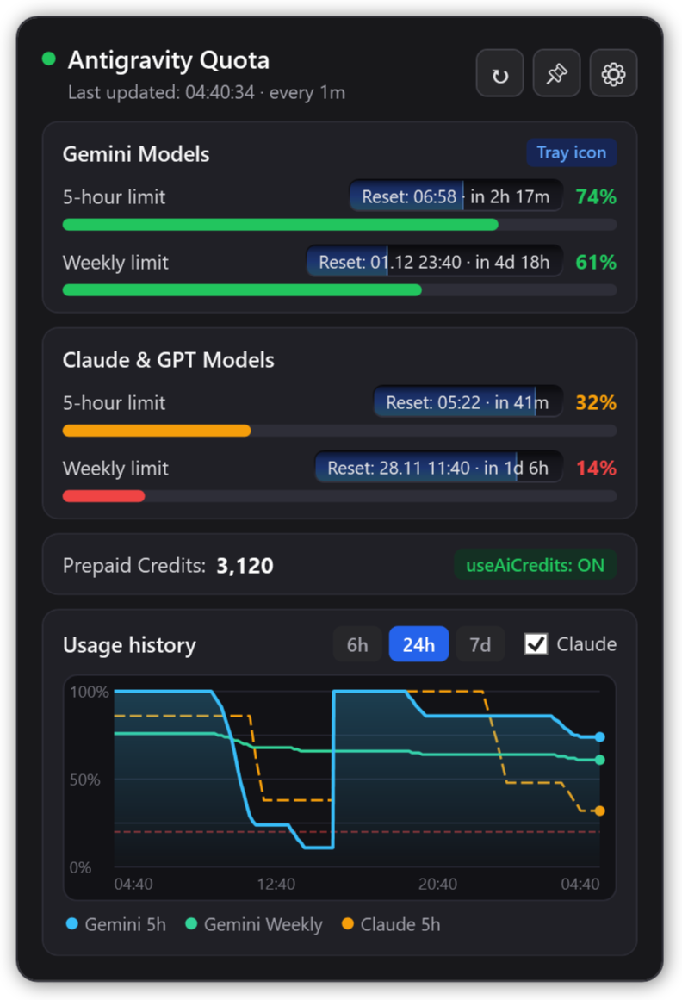
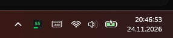

# AntigravityQuotaTray

A lightweight, native Windows system tray application (**.NET 8 WPF + System Tray**) for monitoring Antigravity model quotas and prepaid AI credits in real time.

<p align="center">
  
</p>

<p align="center">
  
</p>

## Features

- **System Tray Icon (Gemini Models)**
  - Color-coded by remaining quota: green (`>= 40%`), amber (`20%–39%`), red (`< 20%`), gray (loading / no data).
  - 3 selectable icon styles in settings:
    1. **5h number + weekly bar** *(default)* — 5-hour remaining percentage on top and weekly progress bar at the bottom.
    2. **Dual bars (5h / Weekly)** — two horizontal progress indicators.
    3. **Ring gauge** — circular 5-hour indicator with an inner weekly ring.
  - Icon tooltip displays Gemini summary (`Gemini Quota · 5h: ... · Wk: ...`).
- **Dark Popup Window (Hover, Click, Drag & Scroll)**
  - Opens automatically when hovering over the tray icon (~220 ms delay), stays open while moving onto the popup, and hides after leaving both areas (~350 ms).
  - Left-clicking pins/unpins the window; dragging the header moves the window anywhere on screen and pins it automatically.
  - Right-clicking opens the context menu (`Refresh now`, `Show / Hide window`, `Start with Windows`, `Open data folder`, `Exit`).
  - Automatically clamps to the monitor working area and scrolls smoothly when the settings panel is expanded.
  - Shows progress bars, percentages, local reset timestamps, and countdowns for both **Gemini Models** and **Claude & GPT Models**.
  - Displays **Prepaid Credits** balance and the `useAiCredits` flag read from `~/.gemini/config/config.json`.
- **Vector Usage History Chart**
  - Persists every successful reading and renders usage over time with a `20%` warning threshold line.
  - Time ranges: **`6h`**, **`24h`**, and **`7d`**.
  - Optional `Claude 5h` overlay alongside `Gemini 5h` and `Gemini Weekly`.
  - Interactive crosshair cursor with a tooltip showing exact timestamp and percentages.
- **Localization, Configuration & Autostart**
  - Built-in language switcher: **English** *(default)* and **Polish**.
  - Configurable polling interval: `1`, `2`, `5`, `10`, `15`, `30`, or `60` minutes (default: **1 minute**).
  - Windows startup integration via `HKCU\Software\Microsoft\Windows\CurrentVersion\Run`.

## Requirements

- Windows 10 / 11 (x64)
- **.NET 8 Desktop Runtime** (or .NET 8/9/10 SDK to build from source)
- Official **`agy.exe`** CLI available in `PATH` or at `%USERPROFILE%\.gemini\bin\agy.exe`

## How It Works

In the background (with no console window), the app runs two parallel commands against the official CLI:
- `agy.exe -p "/usage" --output-format json --print-timeout 15s`
- `agy.exe -p "/credits" --output-format json --print-timeout 15s`

It also reads `userSettings.useAiCredits` from `%USERPROFILE%\.gemini\config\config.json`. No unofficial tools or separate authentication tokens are used or stored.

## Building, Testing, and Publishing

Run the following commands from the repository root:

```powershell
# Build solution
dotnet build AntigravityQuotaTray.sln -c Release

# Run unit tests
dotnet test AntigravityQuotaTray.sln -c Release

# Publish single-file executable to publish\
dotnet publish AntigravityQuotaTray\AntigravityQuotaTray.csproj -c Release -o publish
```

The compiled executable is written to `publish\AntigravityQuotaTray.exe`.

> **Note after moving the executable:** launch `publish\AntigravityQuotaTray.exe` from its new location. On startup, the app automatically updates the Windows autostart registry entry (`HKCU\Software\Microsoft\Windows\CurrentVersion\Run\AntigravityQuotaTray`) to point to the current `.exe` path.

## Project Structure

```text
AntigravityQuotaTray/
├── AntigravityQuotaTray.sln
├── AntigravityQuotaTray/
│   ├── AntigravityQuotaTray.csproj
│   ├── Assets/
│   │   └── app.ico                     # Multi-resolution application icon
│   ├── App.xaml / App.xaml.cs          # Single-instance Mutex, polling timer, lifecycle & crash handlers
│   ├── Models/
│   │   └── QuotaModels.cs              # Quota, history, language, and AppSettings models
│   ├── Services/
│   │   ├── AppLogger.cs                # Rotating file logger (app.log, 2 MB cap)
│   │   ├── AppStrings.cs               # English (default) and Polish localization strings
│   │   ├── AgyQuotaFetcher.cs          # agy.exe (/usage, /credits) runner and JSON parser
│   │   ├── HistoryStore.cs             # history.jsonl persistence with 30-day retention
│   │   ├── SettingsStore.cs            # settings.json persistence
│   │   └── AutostartManager.cs         # HKCU\...\Run registry manager
│   ├── Tray/
│   │   ├── NativeMethods.cs            # P/Invoke (DestroyIcon, GetCursorPos)
│   │   ├── TrayIconRenderer.cs         # 32x32 Gemini tray icon renderer (3 styles) and tooltip
│   │   └── TrayManager.cs              # NotifyIcon, hover/click handling, dark context menu
│   └── UI/
│       ├── HistoryChartControl.cs      # Vector usage history chart with hover tooltip
│       └── PopupWindow.xaml / .cs      # Dark draggable/scrollable popup window and settings
├── AntigravityQuotaTray.Tests/
│   ├── AntigravityQuotaTray.Tests.csproj
│   └── QuotaAppTests.cs                # Unit tests for parser, history, settings, logger, i18n, and icons
└── publish/                            # Git-ignored single-file publish output
```

## App Data & Windows Registry

- **Configuration**: `%LocalAppData%\AntigravityQuotaTray\settings.json`
- **Reading history**: `%LocalAppData%\AntigravityQuotaTray\history.jsonl` (entries older than 30 days are pruned automatically)
- **Diagnostic logs**: `%LocalAppData%\AntigravityQuotaTray\app.log` (automatically rotated to `app.log.1` at 2 MB)
- **Windows autostart**: `HKCU\Software\Microsoft\Windows\CurrentVersion\Run` → `AntigravityQuotaTray`
